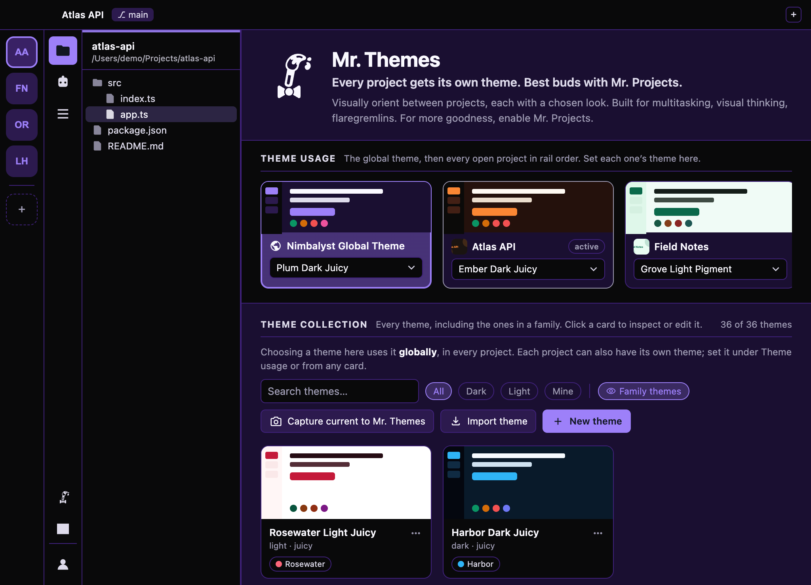
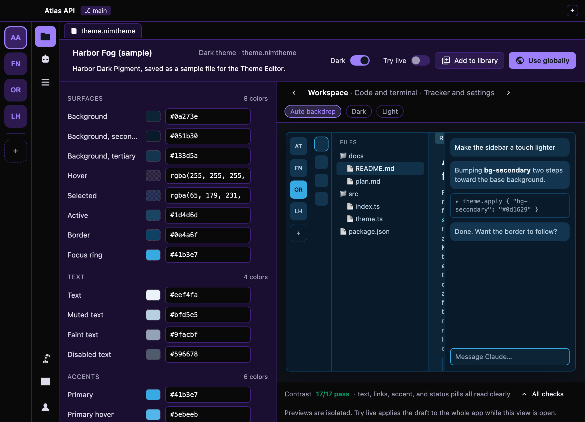

# Mr. Themes

Color themes for [Nimbalyst](https://nimbalyst.com). Use one everywhere or a different one per project, tweak any of them, or make your own.

<picture>
  <source media="(prefers-color-scheme: light)" srcset="screenshots/com.fireworklabs.theme-editor-0-light.png">
  
</picture>

- 36 themes in six families, light and dark, all checked for readable contrast
- See and change which theme each project uses
- Edit any theme with a live preview
- Share themes as files, or have your agent design a family with the included Family Builder Kit

<picture>
  <source media="(prefers-color-scheme: light)" srcset="screenshots/com.fireworklabs.theme-editor-2-light.png">
  
</picture>

## Install

In Nimbalyst's extension Marketplace, scroll to **Install from GitHub** and paste:

```
https://github.com/Firework-Labs/nimbalyst-mr-themes
```

Goes well with [Mr. Projects](https://github.com/Firework-Labs/nimbalyst-mr-projects).

## Good to know

To theme the whole app, Mr. Themes goes a little beyond Nimbalyst's extension API, so a Nimbalyst update can leave a theme half applied until Mr. Themes catches up. Turning it off brings back Nimbalyst's own theme. More in [docs/details.md](docs/details.md).

MIT license.
